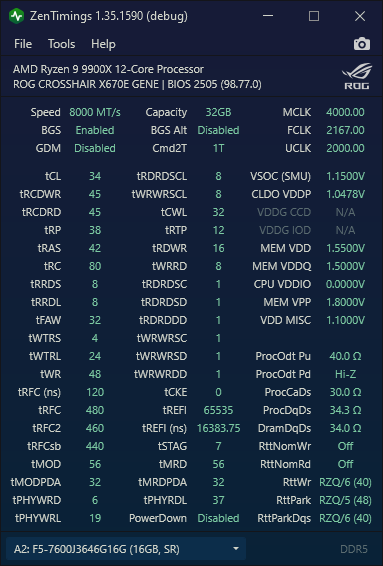

# ZenTimings 汉化版（简体中文）



基于 [irusanov/ZenTimings](https://github.com/irusanov/ZenTimings) v1.42 的**简体中文汉化版本**，功能与原版一致，仅新增界面中文化并修复了若干相关问题。

> 本仓库不是 GitHub fork，是独立仓库。许可沿用上游 **GPL v3**。

---

## 一、不想编译？直接用便携版

1. 到本仓库右侧的 **Releases** 页面，下载最新的 `ZenTimings-zhCN-portable-*.zip`
2. 解压到任意文件夹（无需安装）
3. 运行 `ZenTimings.exe`

**建议首次以管理员身份运行一次**，这样驱动能正常加载；之后用普通权限即可。

> 如果你需要 AMD 平台的完整数据，程序会在首次启动时检查并提示安装 **PawnIO** 驱动，按提示安装即可。

---

## 二、汉化说明

### 切换语言

**工具 → 选项 → 常规 → 界面语言**，下拉框选择，**即时生效**，无需重启。

- 首次启动会按系统语言自动选择（中文系统 → 简体中文）
- 选择会保存在程序目录的 `settings.xml` 里

### 保留了英文的部分

以下按行业惯例保留原文，**不是漏翻译**：

| 类别 | 例子 |
|---|---|
| 内存时序参数 | `tCL`、`tRCDWR`、`tRFC`、`tREFI`、`tFAW`、`tCWL` |
| 时钟与电压 | `MCLK`、`FCLK`、`UCLK`、`VSOC`、`CLDO VDDP`、`VDDG CCD/IOD` |
| 阻抗与驱动强度 | `ProcOdt`、`RttNom`、`RttWr`、`RttPark`、`ClkDrvStr`、`AddrCmdSetup` |
| 端接与参考电压 | `CA ODT A/B`、`CK ODT A/B`、`VrefCA`、`VrefDQ`、`WCK:CK` |
| 专有名词 | `SPD`、`APOB`、`AOD`、`AGESA`、`EXPO`、`ECC`、`DRAM`、`PMIC`、`PawnIO` |

这些符号在 BIOS、超频社区和上游文档里都是英文，翻译成中文反而难以对照调试。它们的悬停提示（ToolTip）已汉化。

---

## 三、从源码构建

### 环境要求

| 项目 | 要求 |
|---|---|
| 操作系统 | Windows（x64） |
| IDE | Visual Studio 2022 或更高版本 |
| 工作负载 | **.NET 桌面开发**（必须包含 WPF 组件） |
| 目标框架 | .NET Framework 4.7.2 目标包 |
| Git | 可选，仅用于生成版本号（缺失时不影响编译） |

### 构建步骤

```bash
git clone https://github.com/zopdems/ZenTimings-zh-CN.git
```

1. 用 Visual Studio 打开 **`WPF\ZenTimings.sln`**
2. 工具栏把配置从 `Debug` 改成 **`Release`**（分发建议用 Release）
3. 菜单 **生成 → 重新生成解决方案**，或按 **Ctrl+Shift+B**

构建产物输出到 **`WPF\bin\Release\`**。

> 本仓库已把 `ZenStates-Core`（驱动核心）作为普通目录纳入，**不需要** `git submodule update --init`。

### 产物清单

| 文件 | 说明 |
|---|---|
| `ZenTimings.exe` | 主程序 |
| `ZenStates-Core.dll` | 驱动核心（CPU / SMU / 内存控制器访问） |
| `ZenTimings.exe.config` | 运行时配置 |
| `inpoutx64.dll` | 读取 APOB / AOD / AGESA 用的驱动库（64 位） |
| `WinIo32.dll`、`WinIo32.sys` | 32 位备用驱动库 |
| `*.LICENSE.txt` | InpOut、WinIo 的第三方许可 |

> `inpoutx64.dll` 由主项目的 `CopyIoDriverLibraries` 目标在构建后自动复制到输出目录。
> 上游仓库只提交了 32 位版本，本仓库已补齐 64 位。

---

## 四、制作便携版

编译完成后，把 `WPF\bin\Release\` 打成 ZIP 即可。

### 方式一：用打包脚本（推荐）

仓库自带脚本，只需要 Python 3（无第三方依赖）：

```bash
python Scripts/make_portable.py           # 默认 Release
python Scripts/make_portable.py Debug     # 也可指定 Debug
```

产物：`ZenTimings-zhCN-portable-YYYYMMDD.zip`，位于仓库根目录。

脚本会：

- 排除 `*.pdb` 调试符号和本机的 `settings.xml`
- 写入一份只含 `<Language>zh-CN</Language>` 的 `settings.xml`，**开箱即中文**
- 自动优先 Release，缺失时退回 Debug

### 方式二：手动打包

把 `WPF\bin\Release\` 下的这些文件打进 ZIP：

```
ZenTimings.exe
ZenTimings.exe.config
ZenStates-Core.dll
inpoutx64.dll
WinIo32.dll
WinIo32.sys
InpOut.LICENSE.txt
WinIo32.LICENSE.txt
LICENSE
README.md
```

**不要**打包 `*.pdb`、`settings.xml`、`crash.log`——它们含有本机路径和调试信息。

---

## 五、驱动相关

ZenTimings 用到两个驱动：

| 驱动 | 用途 | 说明 |
|---|---|---|
| **PawnIO** | 内存时序、频率、电压等主界面数据 | 主要驱动。首次启动会检查并提示安装 |
| **inpoutx64** | APOB 表、AOD 表、AGESA 版本 | 辅助。缺失时主界面数据不受影响 |

### 常见提示

**「I/O 驱动无响应或未加载」** —— inpoutx64 未加载。它只影响 APOB / AGESA 的显示，内存时序等主数据照常。以管理员身份运行一次即可。

**退出时提示无法停止 inpoutx64（错误 1052）** —— 表示有其它程序（HWiNFO、AIDA64、MSI Center 等）正占用该驱动。无害，本版已对该错误静默处理，不再弹窗。若想彻底卸载，重启后不要开监控软件再退出，或用管理员命令行执行 `sc delete inpoutx64`。

也可以在 **工具 → 选项 → 驱动** 里取消「关闭时卸载 inpoutx64 驱动」彻底关闭该行为。

---

## 六、目录结构

```
ZenTimings-zh-CN/
├── WPF/                       主项目（要打开的解决方案在这里）
│   ├── ZenTimings.sln         ← 用 VS 打开这个
│   ├── ZenTimings.csproj
│   ├── Localization/          ★ 汉化相关
│   │   ├── Strings.xaml           英文资源（默认，298 条）
│   │   ├── StringsChinese.xaml    简体中文资源（298 条）
│   │   ├── LocalizationManager.cs 语言切换与系统语言探测
│   │   └── LocExtension.cs        XAML 标记扩展
│   ├── Helpers/DriverCleaner.cs  驱动清理（含 1052 修复）
│   └── bin/Release/           构建产物
├── ZenStates-Core/            驱动核心（原为子模块，现为普通目录）
├── DriverCleaner/             独立清理进程
├── Scripts/make_portable.py   便携版打包脚本
└── External 第三方库许可
```

> 注意：中文资源文件**不能**命名为 `Strings.zh-CN.xaml` 或 `Strings.zhCN.xaml`。
> MSBuild 的 `AssignCulture` 会把这类后缀识别为区域性标记，资源名不会按预期路径注册，
> pack URI 定位不到，界面就切不了中文。这也是最终命名为 `StringsChinese.xaml` 的原因。

---

## 七、许可与署名

- 本项目基于 **irusanov/ZenTimings**（作者 Ivan Rusanov），许可 **GPL v3**
- 汉化部分同样以 **GPL v3** 发布
- 第三方组件：
  - [InpOut32/x64](https://www.highrez.co.uk/downloads/inpout32/) — MIT 风格许可，见 `InpOut.LICENSE.txt`
  - WinIo — 自带 EULA，见 `WinIo32.LICENSE.txt`

### 上游使用的项目

[Adonis UI](https://benruehl.github.io/adonis-ui/) ·
[RTCSharp](https://github.com/tomrus88/RTCSharp) ·
[ryzen_smu](https://gitlab.com/leogx9r/ryzen_smu/) ·
[ryzen_nb_smu](https://github.com/flygoat/ryzen_nb_smu) ·
[zenpower](https://github.com/ocerman/zenpower) ·
[Linux kernel](https://github.com/torvalds/linux) ·
[AMD 公开文档](https://www.amd.com/en/support/tech-docs) ·
[Open Hardware Monitor](https://github.com/openhardwaremonitor/openhardwaremonitor)
